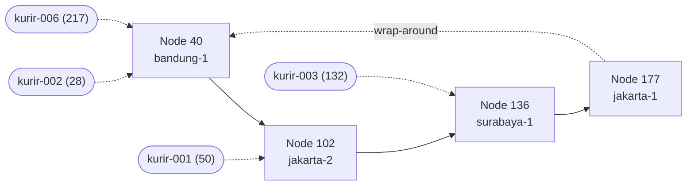

# Tugas 6 — Penamaan & Resolusi Lokasi (Chord DHT)

Simulasi Chord DHT single-process untuk memetakan **ID Kurir → IP terkini** (`m = 8`, ruang 0–255).
Jalankan: `python3 src/chord_simulation.py` — output lengkap ada di `bukti/output.txt`.

## 1. Kenapa DHT/Chord, bukan tabel pusat atau DNS?

| Aspek | Tabel pusat ID→IP | DNS konvensional | Chord DHT |
|---|---|---|---|
| Single point of failure | Ya, server tabel mati = semua lookup gagal | Hierarki; zona/server otoritatif tetap titik tunggal per zona | Tidak ada; data tersebar di banyak node |
| Bottleneck | Semua lookup & update ke satu server | Update harus lewat server otoritatif | Beban terbagi rata lewat consistent hashing |
| IP sering berubah | Update ke satu tempat, tapi jadi hot-spot | Record dikontrol zona + TTL/cache → alamat basi sampai TTL habis | Update hanya ke satu node penanggung jawab; lookup selalu ke sumber itu |
| Nama | Flat | Terstruktur (hierarkis), cocok untuk nama yang stabil | Flat (ID kurir tidak perlu bermakna hierarki) |
| Skalabilitas | Vertikal | Baik untuk nama jarang berubah | Lookup O(log N) pada Chord penuh dengan finger table |

Kurir adalah entitas yang **identitasnya tetap tetapi lokasinya sering berubah**. Ini kasus khas *flat naming*: ID tidak membawa informasi lokasi, sehingga butuh mekanisme resolusi. DNS dirancang untuk nama terstruktur yang jarang berubah dan mengandalkan caching, sehingga kurang cocok untuk update sangat sering. Tabel pusat sederhana tetapi menjadi single point of failure dan bottleneck. DHT membagi tanggung jawab ke banyak node sehingga tidak ada titik tunggal, dan ketika node masuk/keluar hanya sebagian kecil key yang berpindah (lihat bagian 3).

> Catatan: simulasi ini memakai pencarian successor langsung (`find_successor` memeriksa semua node), bukan routing finger table, sehingga kompleksitas O(log N) tidak disimulasikan.

## 2. Ring topology

Hash dihitung dengan SHA-1 mod 256. Node (urut berdasarkan id) dan kurir pada kondisi awal:

| Node | id | Kurir yang dipegang |
|---|---|---|
| node-bandung-1 | 40 | kurir-002 (h=28), kurir-006 (h=217, *wrap-around*) |
| node-jakarta-2 | 102 | kurir-001 (h=50) |
| node-surabaya-1 | 136 | kurir-003 (h=132) |
| node-jakarta-1 | 177 | — |



Aturan: key dipegang oleh **successor**, yaitu node dengan id terkecil yang ≥ hash key. Key 217 lebih besar dari semua node, jadi ring melingkar kembali ke node id 40.

## 3. Perubahan topologi

**Join** `node-makassar-1` (id=63). Successor lamanya adalah node 102. Key dengan hash ≤ 63 yang tadinya di node 102 berpindah:

```
[JOIN] Node 'node-makassar-1' (id=63) bergabung, alamat 10.0.0.5
       -> key 'kurir-001' (hash=50) pindah: node id=102 (10.0.0.2) => node id=63 (10.0.0.5)
```

**Leave** `node-surabaya-1` (id=136) yang memegang `kurir-003`. Successor baru untuk hash 132 adalah node 177 (next di ring):

```
[LEAVE] Node 'node-surabaya-1' (id=136, 10.0.0.4) keluar dari ring
       -> key 'kurir-003' (hash=132) pindah: node id=136 (10.0.0.4) => node id=177 (10.0.0.1)
```

Setelah leave, `lookup("kurir-003")` tetap mengembalikan `192.168.1.12`, hanya node penanggung jawabnya yang berbeda (177). Key lain tidak tersentuh, ini inti keunggulan consistent hashing: hanya data milik node yang bergabung/keluar yang berpindah.

Batasan simulasi: tidak ada replikasi. Pada Chord nyata, data node yang crash mendadak (bukan leave yang rapi) akan hilang tanpa replika di successor list.


## Rubrik Penilaian (Tugas 6)

| Komponen | Bobot | Kriteria |
|---|---|---|
| Implementasi lookup/join/leave benar | 35% | Consistent hashing & successor lookup sesuai aturan Chord |
| Bukti perubahan topologi (join/leave) | 25% | Output menunjukkan mapping berpindah dengan benar |
| Analisis kenapa DHT vs flat naming/DNS | 25% | Argumen spesifik ke kasus IP kurir dinamis, bukan definisi umum |
| Proses & kontribusi kelompok | 15% | `JURNAL.md`, commit history |

## Batasan Penggunaan AI (Level 2)

Kebijakan **Level 2 (AI Assisted Idea Generation & Structuring)** berlaku — lihat [`../RUBRIK-UMUM.md`](../RUBRIK-UMUM.md). Boleh bertanya konsep umum consistent hashing/Chord ke AI; **tidak boleh** meminta AI menuliskan isi `# TODO` di `src/chord_simulation.py` (`find_successor`, `join`, `leave`, dst). Catat pemakaian AI di "Log Penggunaan AI" pada `JURNAL.md`.

- `README.md` wajib menelusuri manual (langkah demi langkah) bagaimana `lookup()` menemukan successor untuk salah satu ID Kurir contoh yang dipakai di `chord_simulation.py` — bukan cuma menempelkan output program.
