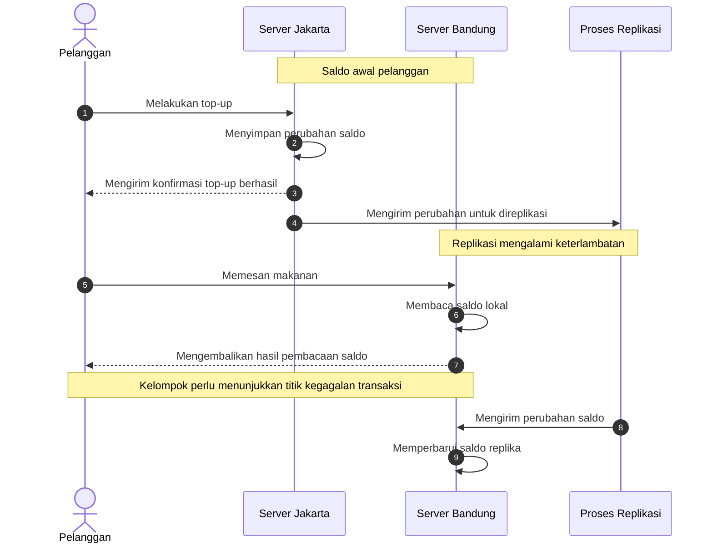
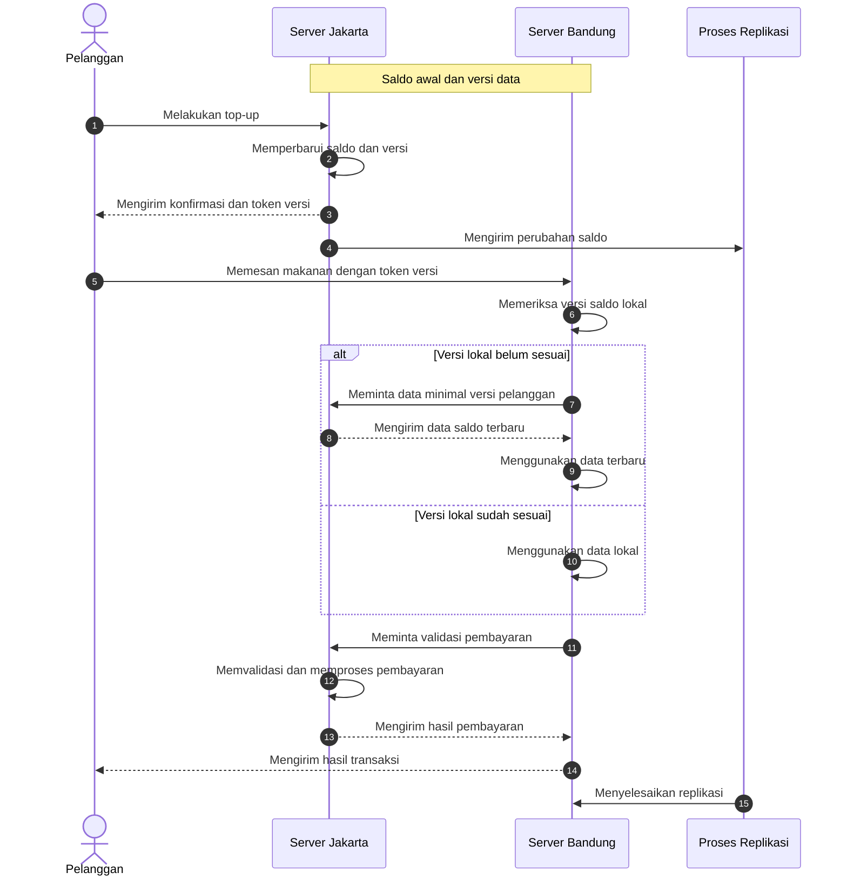

# Tugas 7 (Pekan 7) — Konsistensi Data

Materi terkait: Data-Centric Consistency (Sequential, Eventual), Client-Centric Consistency.

**Kelompok: Kelompok 6**

| Nama | NIM |
|---|---|
| Riandhika Bagus Rosdyantoro | 103072400088 |
| Aziz Faadihilah| 103072400103 |
| M Naufal Sniper H.A. | 103072430003 |

## Studi Kasus

Data saldo *e-wallet* pelanggan FoodGo berbeda antara server wilayah **Jakarta** dan **Bandung** karena replikasi antar server berjalan lambat. Contoh kasus nyata: pelanggan top-up saldo lewat server Jakarta, lalu dalam hitungan detik memesan makanan lewat aplikasi yang tersambung ke server Bandung — saldo belum ter-update, transaksi ditolak padahal saldo sebenarnya cukup.

## Tugas Kelompok

### Bagian 1 — Analisis (wajib)

**1. Tentukan: apakah kasus ini membutuhkan Sequential Consistency (semua replika melihat urutan operasi yang sama) atau cukup Eventual Consistency (replika akan konsisten "pada akhirnya", boleh sementara berbeda)? Berikan argumen berbasis dampak bisnis (mis. kasus saldo e-wallet jauh lebih sensitif dibanding kasus "jumlah like" di media sosial).**

**Jawaban:**

Menurut kami, Eventual Consistency saja belum cukup untuk diterapkan pada kasus FoodGo. Hal ini karena Eventual Consistency hanya memastikan bahwa data pada seluruh server akan sama pada akhirnya, tetapi tidak menjamin data langsung diperbarui setelah terjadi perubahan. Jadi, masih memungkinkan server Jakarta dan Bandung memiliki informasi saldo yang berbeda untuk sementara waktu.

Contohnya, pelanggan melakukan top-up saldo sebesar Rp100.000 melalui server Jakarta. Setelah itu, pelanggan langsung memesan makanan melalui server Bandung. Namun, karena proses replikasi belum selesai, server Bandung masih membaca saldo sebelumnya. Akibatnya, transaksi pelanggan ditolak padahal saldo sebenarnya sudah bertambah.

Menurut kami, masalah ini cukup merugikan FoodGo karena berhubungan langsung dengan uang pelanggan. Jika transaksi sering gagal akibat saldo yang belum diperbarui, pelanggan bisa merasa kecewa dan kehilangan kepercayaan terhadap aplikasi. Bahkan, pelanggan mungkin memilih menggunakan layanan lain.

Hal ini berbeda dengan jumlah like di media sosial. Jika jumlah like terlambat diperbarui beberapa detik, dampaknya tidak terlalu besar karena tidak berkaitan langsung dengan transaksi keuangan. Sedangkan pada FoodGo, keterlambatan informasi saldo bisa menyebabkan pelanggan tidak dapat melakukan pembayaran.

Sequential Consistency memang dapat membantu karena setiap replika melihat urutan operasi yang sama. Namun, penerapannya secara menyeluruh juga bisa membuat proses komunikasi antarserver menjadi lebih lambat. Menurut kami, kebutuhan utama FoodGo adalah memastikan pelanggan bisa melihat saldo terbaru setelah melakukan top-up, meskipun sedang terhubung ke server yang berbeda.

Oleh karena itu, Eventual Consistency saja tidak cukup untuk kasus ini. FoodGo lebih membutuhkan pendekatan Client-Centric Consistency, khususnya Read-Your-Writes, agar perubahan saldo yang dilakukan pelanggan bisa langsung terlihat oleh pelanggan tersebut.

**2. Jika kalian menyimpulkan Eventual Consistency saja tidak cukup untuk skenario ini, usulkan pendekatan Client-Centric Consistency yang relevan (mis. Read-Your-Writes: pelanggan yang baru top-up harus selalu melihat saldo terbarunya sendiri, walau replika lain belum sinkron).**

**Jawaban:**

Pendekatan yang kami usulkan untuk mengatasi masalah ini adalah Read-Your-Writes. Pendekatan ini memastikan pelanggan dapat melihat perubahan data yang sebelumnya dilakukan oleh dirinya sendiri, meskipun sedang terhubung ke server yang berbeda. Menurut kami, pendekatan ini cocok untuk FoodGo karena permasalahan utamanya adalah pelanggan tidak bisa melihat saldo terbaru setelah melakukan top-up.

Cara kerjanya adalah dengan menggunakan nomor versi (version) pada setiap perubahan saldo. Contohnya, pelanggan memiliki saldo Rp50.000 dengan versi 1. Kemudian pelanggan melakukan top-up sebesar Rp100.000 melalui server Jakarta. Setelah top-up berhasil, saldo berubah menjadi Rp150.000 dan versinya menjadi 2. Server Jakarta kemudian mengirimkan informasi saldo terbaru beserta nomor versi tersebut kepada aplikasi pelanggan.

Ketika pelanggan berpindah ke server Bandung untuk memesan makanan, aplikasi akan mengirimkan nomor versi terakhir yang dimilikinya, yaitu versi 2. Server Bandung kemudian memeriksa versi data saldo yang tersimpan. Jika server Bandung masih memiliki versi 1, berarti data yang dimiliki belum diperbarui. Dalam kondisi tersebut, server Bandung tidak boleh langsung menggunakan saldo lama untuk memproses transaksi. Server Bandung harus mengambil data terbaru dari server Jakarta atau menunggu sampai proses replikasi selesai.

Setelah mendapatkan saldo terbaru dengan versi 2, pelanggan dapat melanjutkan pemesanan makanan tanpa mengalami penolakan akibat informasi saldo yang sudah lama. Dengan cara ini, pelanggan tetap bisa melihat perubahan saldo miliknya sendiri meskipun server lain belum selesai melakukan replikasi.

Namun, pendekatan Read-Your-Writes hanya menjamin pelanggan dapat melihat perubahan yang sebelumnya dilakukan oleh dirinya sendiri. Untuk proses pembayaran, FoodGo tetap perlu melakukan validasi saldo dan pemotongan saldo secara aman agar tidak terjadi pengurangan saldo secara bersamaan atau melebihi jumlah yang tersedia.

**3. Gambarkan diagram alir urutan (sequence diagram) yang menunjukkan operasi read/write antara pelanggan, server Jakarta, server Bandung, dan proses replikasi — untuk skenario tanpa jaminan konsistensi (bug terjadi) DAN skenario dengan solusi yang kalian usulkan (bug teratasi). Pakai Mermaid (`sequenceDiagram`) di `README.md` — lihat contoh cara pakai di Tugas 2.**

**Jawaban:**

**Skenario 1 tanpa jaminan konsistensi (terjadi bug)**



**Skenario 2 dengan solusi yang diusulkan (bug teratasi)**



**Penjelasan Skenario 1:**

Pada skenario pertama, pelanggan melakukan top-up saldo melalui server Jakarta. Setelah top-up berhasil, server Jakarta mengirimkan perubahan saldo ke proses replikasi untuk diteruskan ke server Bandung. Namun, proses replikasi mengalami keterlambatan sehingga server Bandung masih menyimpan saldo lama. Ketika pelanggan memesan makanan melalui server Bandung, sistem membaca saldo yang belum diperbarui. Akibatnya, pelanggan mendapatkan informasi saldo yang salah dan transaksi bisa ditolak meskipun saldo sebenarnya sudah cukup. Setelah proses replikasi selesai, barulah saldo pada server Bandung diperbarui.

**Penjelasan Skenario 2:**

Pada skenario kedua, masalah diatasi menggunakan pendekatan Read-Your-Writes dengan bantuan nomor versi (version). Ketika pelanggan melakukan top-up melalui server Jakarta, sistem memperbarui saldo sekaligus nomor versinya, kemudian mengirimkan token versi terbaru kepada pelanggan. Saat pelanggan berpindah ke server Bandung untuk memesan makanan, aplikasi mengirimkan token tersebut agar server Bandung dapat memeriksa versi saldo yang dimilikinya. Jika versi lokal belum sesuai, server Bandung meminta data terbaru dari server Jakarta. Setelah mendapatkan saldo terbaru, server melakukan validasi pembayaran sebelum transaksi diproses. Dengan cara ini, pelanggan tidak lagi menggunakan informasi saldo lama setelah melakukan top-up sehingga masalah pada skenario pertama dapat diatasi.

### Bagian 2 — Simulasi (opsional, nilai tambah)

Skeleton `src/replica_simulation.py` mensimulasikan dua replika (Jakarta & Bandung) dengan delay replikasi buatan. Lengkapi TODO untuk:

1. Menunjukkan kondisi *inconsistent read* (replika Bandung masih menunjukkan saldo lama walau Jakarta sudah update).
2. Mengimplementasikan mekanisme Read-Your-Writes sederhana (mis. dengan version/timestamp per client) yang memperbaiki masalah tersebut.

```bash
python3 src/replica_simulation.py
```

## Struktur Submission

```text
tugas-07-konsistensi-data/
├── README.md
├── JURNAL.md
├── src/
│   └── replica_simulation.py
└── bukti/
    └── output-simulasi.png
```

## Rubrik Penilaian (Tugas 7)

| Komponen | Bobot | Kriteria |
|---|---:|---|
| Ketepatan pemilihan model konsistensi | 30% | Argumen berbasis dampak bisnis nyata, bukan hafalan definisi |
| Kualitas sequence diagram | 30% | Menunjukkan jelas titik kegagalan & titik perbaikan |
| Usulan solusi client-centric | 25% | Solusi konkret dan dapat diimplementasikan (bukan wacana abstrak) |
| Proses & kontribusi kelompok | 15% | `JURNAL.md`, commit history (+ bonus jika simulasi dikerjakan) |

## Batasan Penggunaan AI (Level 2)

Kebijakan Level 2 (AI Assisted Idea Generation & Structuring) berlaku — lihat `../RUBRIK-UMUM.md`.

Boleh bertanya konsep umum consistency model ke AI untuk brainstorming; tidak boleh meminta AI menuliskan analisis akhir/sequence diagram atau isi `# TODO` di `src/replica_simulation.py` yang tinggal ditempel.

Catat pemakaian AI di "Log Penggunaan AI" pada `JURNAL.md`.

---

## Skenario Tambahan

### Studi Kasus Client-Centric Consistency pada Sistem E-Learning (LMS)

**Deskripsi Skenario**

Kelompok membuat satu studi kasus tambahan dari sistem yang berbeda dari FoodGo untuk menunjukkan pemahaman konsep Client-Centric Consistency.

**Alur Permasalahan**

seorang mahasiswa awalnya memiliki nilai tugas sebesar 70. Kemudian dosen melakukan perubahan nilai menjadi 90 melalui server Jakarta.

1. Dosen memperbarui nilai mahasiswa dari 70 menjadi 90 melalui server Jakarta.
2. Server Jakarta menyimpan perubahan nilai tersebut.
3. Mahasiswa membuka LMS melalui server Jakarta dan melihat nilai terbaru sebesar 90.
4. Beberapa saat kemudian, mahasiswa mengakses LMS kembali melalui server Bandung.
5. Karena proses replikasi belum selesai, server Bandung masih menyimpan nilai lama sebesar 70.
6. Mahasiswa akhirnya melihat nilai yang berbeda meskipun sebelumnya sudah melihat nilai terbaru sebesar 90.

**Analisis Kasus**

Model Client-Centric Consistency yang paling sesuai untuk kasus ini adalah Monotonic Reads. Model ini memastikan bahwa ketika seorang pengguna sudah membaca suatu data terbaru, pembacaan berikutnya tidak boleh menampilkan data yang lebih lama dari data yang sebelumnya sudah dilihat.

Pada kasus LMS, setelah mahasiswa melihat nilai 90 melalui server Jakarta, ketika mahasiswa berpindah ke server Bandung, sistem harus memastikan bahwa nilai yang ditampilkan tidak kembali menjadi 70.

Penerapannya dapat menggunakan nomor versi (version) pada setiap perubahan data. Ketika mahasiswa membaca nilai 90 dengan versi 2, aplikasi menyimpan informasi versi tersebut. Saat mahasiswa mengakses server Bandung, aplikasi mengirimkan versi terakhir yang sudah dibaca. Jika server Bandung masih memiliki versi 1, sistem harus mengambil data terbaru dari server Jakarta atau menunggu sampai proses replikasi selesai.

Dengan cara tersebut, mahasiswa tetap mendapatkan informasi nilai yang sama atau lebih baru dari yang sebelumnya sudah dilihat.

**Dampak pada Sistem**

Jika Monotonic Reads tidak diterapkan, mahasiswa bisa mendapatkan informasi nilai yang berbeda ketika mengakses LMS melalui server yang berbeda. Hal ini dapat menimbulkan kebingungan karena mahasiswa mengira nilai yang sebelumnya sudah diperbarui oleh dosen justru kembali seperti semula.

Selain itu, mahasiswa bisa salah memahami hasil penilaian dan menganggap sistem LMS mengalami kesalahan. Jika terus terjadi, hal ini dapat mengurangi kepercayaan pengguna terhadap sistem pembelajaran online tersebut.

**Kesimpulan**

Berdasarkan skenario tersebut, Monotonic Reads merupakan pendekatan yang sesuai karena dapat menjaga agar mahasiswa tidak melihat kembali data nilai yang lebih lama setelah sebelumnya mendapatkan informasi terbaru. Dengan menggunakan nomor versi, sistem dapat mengetahui data terakhir yang sudah dibaca oleh pengguna dan memastikan server lain tidak memberikan informasi yang lebih lama. Dengan demikian, pengalaman mahasiswa dalam menggunakan LMS menjadi lebih konsisten meskipun mereka mengakses aplikasi melalui server yang berbeda.

---

## Kesimpulan

Berdasarkan hasil analisis yang telah dilakukan, dapat disimpulkan bahwa konsistensi data merupakan hal penting dalam sistem terdistribusi, terutama pada aplikasi yang memiliki banyak server dengan proses replikasi data. Pada kasus FoodGo, keterlambatan replikasi menyebabkan server Jakarta dan Bandung memiliki informasi saldo yang berbeda. Hal ini dapat membuat transaksi pelanggan ditolak meskipun saldo sebenarnya mencukupi. Oleh karena itu, Eventual Consistency saja tidak cukup untuk menangani permasalahan tersebut. Pendekatan Read-Your-Writes dapat digunakan agar pelanggan tetap bisa melihat saldo terbaru setelah melakukan top-up, meskipun berpindah ke server lain.

Pada skenario tambahan sistem E-Learning (LMS), masalah yang terjadi adalah mahasiswa dapat melihat nilai yang berbeda ketika mengakses server yang berbeda karena proses replikasi belum selesai. Untuk mengatasi masalah tersebut, digunakan pendekatan Monotonic Reads agar mahasiswa tidak melihat kembali informasi nilai yang lebih lama setelah sebelumnya mendapatkan nilai terbaru.

Dari kedua studi kasus tersebut, kami memahami bahwa pemilihan model konsistensi harus disesuaikan dengan kebutuhan masing-masing sistem. Setiap aplikasi memiliki jenis data dan dampak permasalahan yang berbeda. Dengan menerapkan model konsistensi yang sesuai, sistem terdistribusi dapat memberikan informasi yang lebih akurat, mengurangi kesalahan pembacaan data, dan meningkatkan kepercayaan pengguna terhadap aplikasi.
